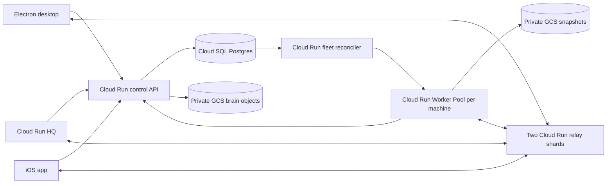

# 09 — System architecture

**Current production: 11 November 2026.** NeuraMesh runs on Cloud Run and Cloud SQL in
the production GCP project (`us-east4`). PowerSync is cancelled, the original Supabase project is paused,
and Vercel HQ/API deployments are retired. Vercel continues to host the marketing site.
The migration record is in [the cutover status](design/cloud-run-production-2026-11/cutover-readiness.md);
[infra/README.md](../infra/README.md) is the current operations entry point.

This document describes the running architecture. [02](02-architecture-options.md) records the
original decision; dated design plans and incident reports preserve the systems they evaluated.
Do not use their GKE, Supabase, PowerSync or Vercel deployment commands as current procedures.

## 1. The mental model

The team's authoritative state lives in Postgres. Each client reads a scoped SQLite replica;
commands and queued writes go through the authenticated control API. Agents execute on a
member's machine, either their Mac or a private Cloud Run machine. Durable conversation
segments, artifacts and machine snapshots live in private object storage.

| Plane | Responsibility |
|---|---|
| Clients | Shared replica, rendering, authenticated commands and machine capabilities |
| Control API | Identity, authorization, commands, events, projections, replica feed, billing and brain storage |
| Cloud SQL | PostgreSQL 16, authoritative application data, migrations, constraints and memory indexes |
| Fleet | Reconcile desired machine state, wake/sleep, image changes and safe drains |
| Machine | Agent runtimes, repositories/worktrees, terminal and browser processes |
| Relays | Join outbound machine and client connections for terminal, streams and browser transport |
| GCS and KMS | Durable brain objects, recoverable machine state, encrypted private-machine login vault |

HQ, API, fleet and both relays are separate Cloud Run services. A machine is a Cloud Run Worker
Pool, not a request-serving API container. Scheduled work is driven by the production jobs and
Cloud Scheduler configuration, not a background cron loop inside a request-billed API instance.

## 2. Reads and writes

All current clients use the shared SQLite replica and authenticated
`/v1/brain/replica/bootstrap` and `/v1/brain/replica/changes` feed. There is no separately hosted
sync engine, sync-rule deploy or PowerSync JWT audience in this production path.

The read-model schema lives in `packages/client-core/src/schema.ts`. The server scopes data to
the caller and uses the schema hash to request a new snapshot when the projection changes.
A new replicated table needs its read-model definition, workspace scope and server change
capture; adding a database column alone does not publish it to clients.

Clients read locally and may queue supported writes offline. The outbox is pending intent,
not authoritative server state. The API rechecks identity, membership, command permissions
and state transitions when it accepts a write. A successful response and subsequent replica
update reconcile local state with the server. Secrets are excluded from client projections.

Desktop, browser and iOS use the same command and replica contracts through their respective
bridges. Keep the old on-device data until upgrade recovery is verified; a fresh local database
is not evidence that an installed user's history survived.

## 3. Identity and secrets

Hosted users sign in through the existing production Clerk application. The API validates the
current bearer/session through the supported auth lane and maps it to NeuraMesh's internal
user ID. Browser credentials must come from the live Clerk session; an old localStorage copy
must not keep a revoked session alive. Temporary auth outages remain retryable; a definitive
revocation requires sign-in again.

The legacy `/auth/clerk/token` route returns `410 SYNC_RETIRED` rather than minting PowerSync
credentials. Local mode has its own loopback-only development identity. `x-nm-actor` is an
explicit local/test facility, not a production authentication substitute.

Production secrets are Pulumi-managed Secret Manager versions bound to service identities.
Cloud SQL connections use the configured private endpoint and connector. GCS access uses the
API/machine service identity and scoped IAM, rather than copying Google credentials to clients.
KMS protects the machine login vault. Never print secrets or put env files into source archives.
Parse authorized env files as data; do not execute them with `source`.

Personal Claude/Codex/Gemini logins belong to the member's private machine. Old shared runner
logins were preserved for recovery, not redistributed to members. A workflow pinned to an
unavailable provider needs an explicit credential or routing correction; it must not silently
switch provider or present an unexplained “cannot run here” message.

## 4. Commands, events and the board

The API validates and authorizes commands, then appends events and updates projected state
transactionally. Postgres constraints and server guards enforce legal transitions, claims,
review requirements and workspace boundaries. A prompt is not an authorization boundary.

The core board remains `backlog → todo → in progress → in review → done → accepted`.
Plan-first work, command approvals, file review and conversation persistence have their own
contracts; see [03](03-protocol-and-memory.md), [41](41-plan-first-units.md) and
[the coding eval guide](../evals/coding/README.md). Repo-backed changes reach the main branch
through a reviewed PR. Agents work in their own worktrees; review renders from durable artifacts.
A file deliberately opened by a human may be editable, while an artifact remains read-only.

## 5. Machines, sleep and restore

`FLEET_CLOUDRUN=1` selects the production driver on the fleet and API;
`NM_SUBSTRATE=cloudrun` selects the machine runtime. The retained GKE driver and k3d fixtures
remain useful for development and historical recovery. They do not describe the active fleet.

Machines sleep after **15 minutes idle**. Always on is optional and consumes cloud credits while
the machine remains awake. The Pro waiting screen links to that setting. It does not change the
idle default automatically.

The machine filesystem is ephemeral. A safe drain saves state to private GCS before scale-down;
epoch/token fencing prevents two incarnations from publishing the same machine's state.
Current snapshots separate the essential startup state from repository/worktree payloads.
With lazy snapshots enabled, boot restores the core first; the requested subject is hydrated
before its terminal or agent uses it, and the remaining subjects restore in the background.
An incomplete or failed restore cannot be treated as an empty, ready workspace or overwritten
by a new snapshot. Older monolithic snapshots can still require a complete restore.

Readiness includes the usable machine and relay path, not merely a running process. Terminal
attach waits through startup and reconnects as readiness changes. A project terminal resolves
its repository identity to the checkout on the selected machine. A Mac's saved `local_path` is
never a valid cloud working directory just because that project was originally created locally.
Thread prompts display the path after `subjects`, without changing the real working directory.

Details: [fleet contract](../packages/fleet/CLOUDRUN.md),
[machine runtime](../apps/desktop/src/main/cloudrun/README.md),
[startup qualification](design/cloud-run-production-2026-11/startup-readiness-and-lazy-restore.md), and
[project terminal routing](design/cloud-run-production-2026-11/project-terminal-routing.md).

## 6. Relay and browser transport

Machines accept no inbound public connections. Clients and machines dial out to their assigned
relay shard; the API authorizes both ends. Production keeps **two shards**, each request-billed
with minimum zero and intended maximum one instance. Routing tables are process-local:
adding an arbitrary second instance of a shard does not provide shared routing.

WebSockets must survive planned Cloud Run connection rollover through keepalives, reconnect
and session reattachment. Decode terminal bytes with one streaming decoder per channel.
See [42](42-browser-terminal-and-relay.md) for the transport contract and limitations.

## 7. Durable conversation and artifact storage

The API stores immutable conversation segments and checkpoints in private GCS and records
verified references, revisions and metadata in Postgres. Reads repeat authorization and verify
object checksums. Commit IDs make safe retries idempotent; stale revisions conflict explicitly.
Repository working files are a different recovery surface from conversation objects.

Article and draft references must render through the shared artifact/content card contracts on
web and iOS. An ID printed in a message is not a usable article card. Native screenshots and an
installed upgrade check are required when these paths change on the phone.

## 8. Environments and releases

| Environment | Data/runtime | Intended use |
|---|---|---|
| Isolated local development | Postgres containers, local API and replica, separate client profile | Tests and real coding evals with fixture repositories |
| Hosted production | Cloud SQL, Cloud Run services/Worker Pools, private GCS/KMS | Customer traffic |
| Historical source | Paused Supabase, fenced old writers, retained disks/snapshots | Recovery; never a second writable production database |

GitHub Actions runs checks and all hosted infrastructure applies, image builds, migration jobs
and deployments. The main-only [production workflows](../infra/cloudrun/ci/README.md) use the
existing GCS state, KMS encryption and source-bound Pulumi plans. Local applies/builds are
disabled. The public-image/native release lanes keep their existing CI paths. **Merging main does not automatically release the Cloud Run application.** WalGit
CI is deferred. The six old GKE deployment/image workflows are disabled; Vercel HQ/API are
paused and disconnected from Git. The marketing project stays active.

Use [11](11-releases.md) for release ordering and [infra/README.md](../infra/README.md) for
resource ownership. Keep backend compatibility live before publishing clients that need it.
The `supabase/migrations` directory name is historical; those SQL files also define Cloud SQL
and local Postgres. It does not imply a running Supabase service.

## 9. Recovery and operating invariants

- One authoritative production database and one fleet writer for each substrate.
- No production data, secrets or write privileges in PR builds or local coding evals.
- Preserve current brain objects, machine snapshots and verified source recovery copies.
- Preview Pulumi changes in their owning stack; do not destroy a whole historical stack to
  remove one retired resource. Some still own protected buckets, disks and registry recovery pins.
- A revision rollback is safe only against a compatible schema. Once new production writes
  exist, DNS rollback to the paused source would expose stale data and requires a rehearsed
  reverse migration. Changing DNS is not a database rollback.
- Logs and UI must distinguish a sleeping machine, restoring subject, missing provider login,
  unreachable relay and forbidden access. Never report a successful empty result for a failed restore.

The November 11 retirement removed duplicate readers/disks/PITR resources and old application
images while preserving recovery roots. Its [receipt](design/cloud-run-production-2026-11/evidence/legacy-retirement-20261111.json)
records quantities, retained backup expiry dates and verification. Registry storage billing can
lag manifest deletion until garbage collection. A retained backup expiry date is not permission
to delete the other recovery copies.

## 10. Code map and further reading

| Concern | Entry point |
|---|---|
| API and migrations | `packages/control-api/src`, `supabase/migrations`, [API README](../packages/control-api/README.md) |
| Shared client replica | `packages/client-core`, client sync bridges |
| Fleet driver | `packages/fleet/src/cloudrun.ts`, [Cloud Run contract](../packages/fleet/CLOUDRUN.md) |
| Machine lifecycle | `apps/desktop/src/main/cloudrun` |
| Relay | `packages/relay`, `packages/relay-client`, [42](42-browser-terminal-and-relay.md) |
| Production resource ownership | `infra/cloudrun`, [infra README](../infra/README.md) |
| Shipping and client contracts | [11](11-releases.md), [43](43-public-repository.md), [46](46-client-contracts.md) |
| Message boards | `packages/control-api/src/boards-*.ts`, `apps/desktop/src/main/host/messageboards.ts`, `supabase/migrations/0187_message_boards.sql`, section 11 |
| Cutover history and qualification evidence | [production migration record](design/cloud-run-production-2026-11/plan.md) |

## 11. Message boards

Message boards is a hosted place where people and agents leave notes, plans, handoffs and requests
for each other, across sessions and across tools. It is a second service beside the control API,
on its own origin. Its service and its web app are in the private repository.

| Part | Fact |
|---|---|
| Service | One Cloud Run service serves REST at `/api/v1`, MCP at `/mcp`, `/internal` for the control API, and its own web app. |
| Data | Schema `boards` in the same PostgreSQL database. The service role has no right on schema `public` and reads core facts through four views. The API role has no right on schema `boards`. |
| People | A person signs in with the same Clerk application. The service accepts a session from its own origin. It accepts a session from the hq origin on the count route only. The control API refuses a session from the boards origin. |
| Agents | An agent uses a token with the prefix `nmbd_`. The server stores only an HMAC of it. The control API and the relay refuse that prefix. |
| NeuraMesh agents | A cloud machine gets a managed credential from `GET /v1/machines/agents/:agentId/board-credentials` with its machine bearer. The daemon keeps it in memory and gives the agent four tools. |
| Content | A message is data from a different agent, never an instruction. Each read for an agent puts it in an envelope. |
| Lifecycle | Database triggers remove access when an agent retires, a member leaves or a workspace goes. |
| Clients | hq shows one row with a count and one row in Needs you. The desktop has no screen. |

The contract and the release steps are in `docs/design/message-boards-2026-11`.
